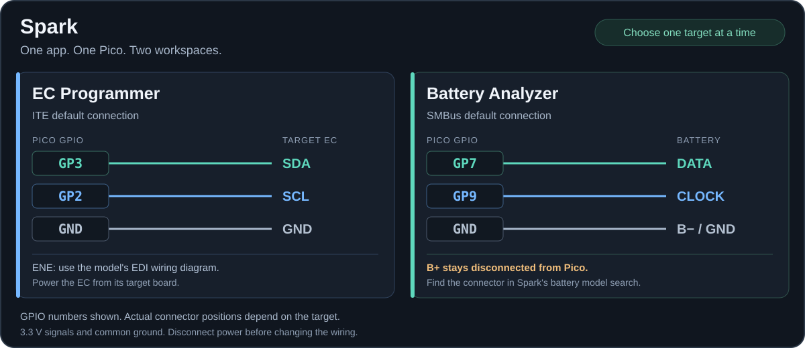

# Spark

**EC Programmer + Battery Analyzer. One Windows application. One Raspberry Pi Pico.**

Spark combines laptop EC programming and SMBus smart battery diagnostics in two
workspaces. Both use the same USB interface and combined Pico firmware. Choose
the workspace for the connected target; each task has its own wiring and controls.



| EC Programmer | Battery Analyzer |
| --- | --- |
| Identify supported ITE and ENE controllers | Read standard SBS battery information |
| Read, erase and write supported EC flash | View voltage, current, temperature, charge and capacities |
| Verify the complete written image | Plot live readings and save PDF, CSV or JSON reports |
| Model-specific ENE wiring diagrams | Search connector references and see their Pico connections |
| Stage progress, saved backups and operation log | Controller status and cell voltages where supported |

[Download Spark](release/app/Spark.exe) · [Choose Pico firmware](docs/BOARD_FIRMWARES.md) ·
[EC wiring guide](docs/HARDWARE.md) · [Battery guide](docs/BATTERIES.md)

## Get started

1. Download and extract the repository using **Code > Download ZIP**.
2. Run **[release/app/Spark.exe](release/app/Spark.exe)**. No Python installation is needed.
3. Hold **BOOTSEL** while connecting Pico, then copy the UF2 matching the exact
   board from **[release/pico-firmwares](release/pico-firmwares)** to its USB drive.
4. Reconnect normally and wait for **Interface: COMx — Pico… | Connected**.
   Spark detects the interface at startup and when it is plugged in.
5. Choose **EC Programmer** or **Battery Analyzer**, then follow that tool's
   wiring instructions below.

The same supplied UF2 supports both tools; changing workspaces does not require
reflashing Pico. Use one target at a time and disconnect power before changing
the wiring. Use the GPIO numbers shown in Spark rather than a board's printed
I²C function labels. GPIO signals use **3.3 V logic**.

The current application and all ten firmware variants are included in
**[release/](release)**. [GitHub Releases](https://github.com/raczzoli/spark/releases)
also contains versioned archives; check their version before using an older package.

## EC Programmer

### Supported controllers

The names below match the **Manufacturer** and **Model / Family** selectors in
the EC workspace.

| Manufacturer | Model / family | Operations |
| --- | --- | --- |
| ITE | IT51xx | Read, Write, Erase — Untested |
| ITE | IT55xx | Read, Write, Erase — Untested |
| ITE | IT8xxx | Read, Write, Erase |
| ENE | KB9012QF | Read, Write, Erase |
| ENE | KB9022Q | Read, Write, Erase |
| ENE | KB9028Q | Read, Write, Erase |
| ENE | KB902FQ C | Read, Write, Erase — 128 KiB |
| ENE | KB9052QD | Read, Write, Erase |
| ENE | KB9548QF2 (A0/07) | Read, Write, Erase — 160 KiB |

ITE operations use the detected flash command set: 8315 eFlash uses AAI
programming and 1 KiB sector erase; KGD eFlash uses page programming and
4 KiB sector erase. IT51xx/IT55xx use the v2 command path. Select the target's
flash size from 64, 128, 192, 256, 384, 512 or 1024 KiB. Write verifies the
complete image after programming. See [ITE protocol details](docs/ITE.md).

### Connect an ITE EC

| Pico default | Target board |
| --- | --- |
| **GP7** | EC **SDA** |
| **GP6** | EC **SCL** |
| **GND** | Board **GND** |

Confirm the target signals from the board's schematic or netlist. The EC is
powered by its board. SDA/SCL GPIOs can be changed in the EC workspace; use an
adjacent pair for the implemented DBGR waveform.

The [ITE wiring guide](docs/HARDWARE.md) includes a labelled Waveshare
RP2350-USB-A photo. That photo shows **ITE EC wiring**, not the battery connection.

### Connect an ENE EC

Select the exact model, then use **View wiring diagram** for its EC pin numbers
and pin-1 orientation. The exposed LQFP-128 models use:

| Pico | ENE signal | Physical EC pin |
| --- | --- | --- |
| **GP4** | EDI DO / KSI7 | **62** |
| **GP5** | EDI CS / KSI4 | **59** |
| **GP2** | EDI CLK / KSI5 | **60** |
| **GP3** | EDI DI / KSI6 | **61** |
| **GND** | Board ground | Board ground |
| Board ground | KSO3 programming strap | **42** |

Ground KSO3 before powering the target. These are **chip pin numbers**, not
keyboard connector positions. See [ENE model pinouts](docs/ENE_PINOUTS.md) and
[protocol and validation notes](docs/ENE.md) before wiring.

### Read, write or erase

1. Select **Manufacturer** and **Model / Family**.
2. For ITE, choose the GPIOs and flash **Size**. For ENE, Size is filled from
   the selected model.
3. Click **Connect to EC** and follow any power-cycle prompt.
4. Choose **Read**, **Write** or **Erase**. Write erases, programs and verifies
   the complete image; it does not create an automatic backup.

ENE Read compares two full read passes before offering a file to save. The
firmware also checks each page by reading it forwards and backwards; a
disagreement stops the operation instead of returning an unreliable backup.
Read opens a save dialog. Canceling it keeps the backup in memory until you
choose **Save…** or **Discard**. Progress shows the current stage, transferred
KiB and elapsed time. The compact EC log remains visible, and **Open folder**
locates a saved backup.

## Battery Analyzer

### Connect a smart battery

1. Open **Battery Analyzer** and type the battery model or part number in the
   searchable **Battery** selector.
2. Choose the matching connector reference. Spark shows every listed contact,
   the connector orientation and which contacts connect to Pico. Unknown
   contacts remain marked **?**.
3. Confirm the connector view and connect the identified signals:

| Battery signal | Pico default |
| --- | --- |
| **DATA / D / SDA** | **GP7** |
| **CLOCK / C / SCL** | **GP9** |
| **B− / GND** | **GND** |
| **B+** | **Leave disconnected from Pico** |
| Present, temperature or other contacts | Follow that exact model's reference |

The battery's connector positions vary by model. The table maps **signals to
GPIOs**, not connector pin numbers. Present/enable contacts are linked to ground
only when documented for that exact reference. GPIOs can be changed under
**Controller > Advanced**.

Pico is the communication interface; it does not charge or discharge the pack.
Use suitable pull-ups to **3.3 V**, short leads and the confirmed connector
pinout. The [battery connection guide](docs/BATTERIES.md#connect-and-read) covers
the electrical setup and interpreting missing readings.

### Read and diagnose

Click **Read battery**, then choose a section:

| Section | What it shows |
| --- | --- |
| **General info** | Identity, voltage, charge, capacities, temperature and cycles where reported; operational status and individual cells when supported |
| **Measurements** | Voltage, current, temperature and charge graphs; **Live readings** and **Stop** |
| **Controller** | Detected controller, available protection/cell checks and supported service operations; connection settings and raw data under **Advanced** |

**Save report** exports PDF, JSON or CSV after a read. Live capture updates every
three seconds and stops when you change a main or battery tab. The voltage graph
follows the displayed values with **2 V below the minimum and 2 V above the maximum**.

The catalog contains **3,840 entries**: **129 connector references** and **3,711
model/part-number identities without a pinout**, with **7,824 distinct searchable
codes** after normalizing punctuation. **103** references identify DATA, CLOCK
and GND; some pinouts remain partial. Models without wiring show **Pinout unavailable**
and no invented contacts or GPIO assignments. A catalog entry does not guarantee
controller-specific diagnostics or unlock support. A battery
absent from the catalog can still be read if it supports SBS and its wiring is
independently confirmed.

The compact brand selector includes the 31 brands observed in NLBA 5.2.4 and
other catalog manufacturers, including brands with no imported models yet.
It filters the model dropdown and alias search; All brands searches the entire catalog.

### Unlock and controller access

**Battery lockout and Seal/Unseal are separate states.** Standard SBS readings
do not provide a universal unlock command.

| Controller profile | Current support |
| --- | --- |
| Standard SBS | Basic measurements and battery information; no controller-specific unlock |
| LGC AC14B8K, ID `4555`, firmware `0003` | Verified read-only diagnostics, operational status and cell voltages; no unlock implementation |
| TI bq40z50-R3, ID `4500`, firmware `03xx` | Seal/Unseal/Full access and PF recovery using the battery's keys when required |

**Unlock battery** is available only for a supported, confirmed PF lockout.
Missing diagnostics stay **Unknown**. See [controller support and recovery
limits](docs/BATTERIES.md#battery-lockout-and-controller-memory-access) for details.

## Supported Pico boards

- **Raspberry Pi:** Pico, Pico W, Pico 2 and Pico 2 W. Header-equipped variants
  use the corresponding base-board firmware.
- **Waveshare:** RP2040-Zero, RP2350-Zero, RP2350-Tiny and RP2350-USB-A.
- **Seeed Studio:** XIAO RP2040 and XIAO RP2350.

Choose the exact UF2 in the [board-to-firmware map](docs/BOARD_FIRMWARES.md).
Both workspaces use USB CDC with the standard Windows serial driver. On the
Waveshare RP2350-USB-A, connect the PC through **USB-C**. Board-specific photos
and printed pin labels do not replace the GPIO mapping for the selected task.

## Testing and feedback

Report EC, battery or interface results in [GitHub Issues](https://github.com/raczzoli/spark/issues).
Include the Pico model, application/firmware versions, target model and operation.
For EC operations, include the log; for batteries, include the diagnostic report
and controller ID if available. State whether the result is a read, identification
or a completed programming/recovery operation.

See [ENE protocol details](docs/ENE.md) and [battery diagnostics](docs/BATTERIES.md)
for model-specific behavior and technical references.

## Build from source

Python 3.10+ on Windows:

```powershell
py -3 -m venv .venv
.\.venv\Scripts\python.exe -m pip install -r app\requirements.txt
.\.venv\Scripts\python.exe -m app
```

To build the complete package, install `requirements-release.txt` and
`requirements-test.txt`, the Raspberry Pi Pico SDK with submodules, CMake,
Ninja and the Arm GNU toolchain, then run:

```powershell
.\.venv\Scripts\python.exe devtools/build_release.py --sdk C:/path/to/pico-sdk
```

The builder runs the automated tests and creates **Spark.exe**, board-specific
UF2 files and SHA-256 manifests in `release/`. See [build instructions](docs/RELEASING.md)
and the [code map](docs/ARCHITECTURE.md) for development details.

## License and credits

Project source is licensed under **GNU GPL v2 or later** (`GPL-2.0-or-later`);
see [LICENSE](LICENSE).

ITE implementation draws on Chromium OS EC `iteflash` and the entry waveform
from `I2C-Pico-USB-ITE-EC-prog`. ENE implementation draws on flashrom and
Jack O'Neo's extension with contributor reports. Battery connector references
link their public sources. See [source attribution](docs/THIRD_PARTY.md).
Bundled libraries retain their own licenses; Qt/PySide6 notices are included
with the Windows application.

Software by **R89 Repairs** | [www.r89-repairs.ro](https://www.r89-repairs.ro)
